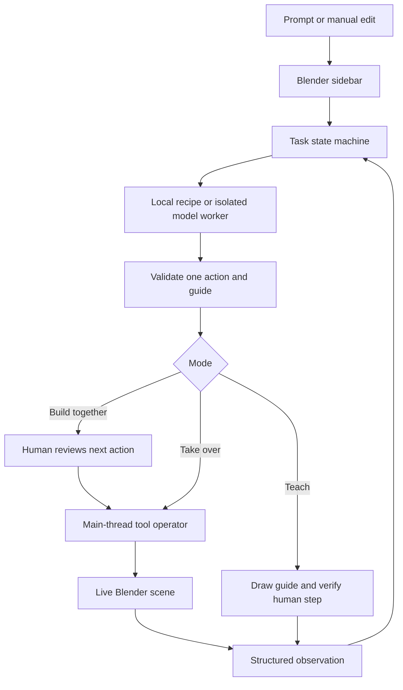

# Architecture and decisions

The native sidebar accepts a request and chooses the collaboration mode. A main-thread timer drives one active task. Local Demo or an isolated network worker returns one structured action and guide. The protocol validator rejects malformed/out-of-scope requests. A Blender operator applies one action with Undo support. A fresh observation supplies the next decision.

## Where things live

| File | Responsibility |
|---|---|
| `extension/__init__.py` | State machine, timer, process lifecycle, operators, chat sidebar and task controls |
| `extension/protocol.py` | Bounded schemas, numeric/type validation, response parsing and scene signatures |
| `extension/scene_tools.py` | Scene observation, primitive creation, material isolation, human-step verification |
| `extension/demo.py` | Finite local recipes and simple live object anchors |
| `extension/overlays.py` | Actual GPU/BLF viewport cards, region highlights and calibrated UI rings |
| `extension/worker.py` | Standard-library HTTP; runs in its own process and never imports `bpy` |

## Decision — don't block Blender while calling the model

**Problem:** v0.1 performs network calls and repeated mutations synchronously inside one operator. Blender can't service pause/stop or reliably display intermediate results until it returns.

**Choice:** A subprocess does network IO; a 150 ms timer reads its response and schedules at most one small main-thread scene operation. Blender Python threading is explicitly unsupported by [the Blender documentation](https://docs.blender.org/api/main/info_gotchas_threading.html).

**Trade-off:** Process startup adds overhead, especially on installations where the fallback must launch background Blender rather than bundled Python. It makes cancellation explicit and avoids `bpy` from worker threads.

## Decision — Teach Me proposes an action but never executes it

The same action schema describes what the human should do. Guide text contains the menu/shortcut and exact values. The verifier compares the live scene to the step baseline. An explicitly selected matching primitive can be accepted with human-selected proportions. Existing user objects aren't tagged or renamed by teaching verification.

This checks outcomes, not every click. A person can follow a shortcut instead of the pointed menu and still succeed. Primitive recognition is a topology heuristic, not an image classifier.

## Decision — exact UI pointers need calibration

The public `bpy` interface exposes editor regions, not robust bounding boxes for every button. Default guidance uses editor regions and named controls; Pin Pointer records a control location the user actually clicked. Normalized coordinates adapt to region scaling, but scrolling/layout changes require re-pinning. No invented coordinates from an LLM are accepted.

## Decision — keep human control over polish

Build With Me previews an action before applying it, then pauses. Skip records that a material/bevel/transform step was intentionally omitted. Take Over accepts a larger degree of autonomy but yields between steps; any detected manual scene change cancels its pending action and pauses.

Stop keeps already-applied work. The application doesn't guess whether every historical manual edit should be rolled back. Undo/Redo discards the active session's history to prevent replay against a different scene.

## State transitions

| State | What can happen |
|---|---|
| IDLE / STOPPED / COMPLETE | Send starts a new task |
| THINKING | Pause/Stop cancel the request; only a non-stale validated result proceeds |
| READY | Build With Me waits for Apply; a changed scene discards the proposal |
| TEACHING | Human edits and Check My Step verifies; no tool execution |
| RUNNING | Timer waits, applies one action, waits again, and requests a fresh next step |
| PAUSED | Human edits; Resume observes and re-plans the uncompleted step |

## Model vs provider

Nebius is the inference provider. An NVIDIA Nemotron model would generate the decision/guide. The extension supplies observations, controls permitted actions, validates results and operates Blender. Switching providers doesn't create new Blender capabilities. A more capable model may plan better within the tool surface; it cannot use a feature that the application has not implemented.

The current model boundary uses chat-completions with JSON instructions and strict local validation. The [Nebius docs](https://docs.tokenfactory.nebius.com/ai-models-inference/json) describe optional schema/JSON output support, which varies by model. This prototype doesn't force that parameter on a model without confirming support. Future model integration should test supported structured-output options and native tool calling.
