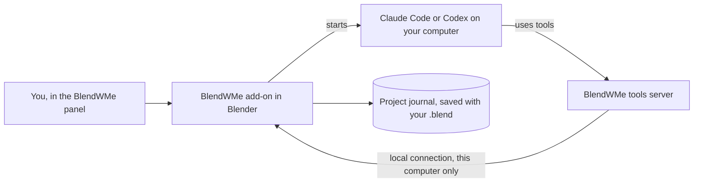

<p align="center">
  <picture>
    <source media="(prefers-color-scheme: dark)" srcset="assets/logo/blendwme-logo-blender-transparent.svg">
    
  </picture>
</p>

<p align="center"><b>A Blender artist and coach who sits inside your Blender and works with you.</b></p>

<p align="center">
  Blender 4.2 LTS · Windows · Claude Code or Codex · MIT licence
</p>

## Why this exists

I tried to learn Blender properly. I really did. I made the donut. I made the second donut, because
the first one looked like a bagel that had seen things. Then I opened a blank scene, stared at the
default cube, pressed a key I thought was "grab", and Blender quietly deleted half my mesh. Every
tutorial I watched was either "click here, then here, then here" at 2x speed, or a three-hour deep
dive that assumed I already knew what a normal was. (I did not. I thought it was a mood.)

At some point I stopped fighting the learning curve and hopped on the AI train. The usual AI tools
for Blender can drop a cube, a sphere and a cylinder into a scene from a prompt. That's a nice party
trick, but it doesn't feel like working with someone who actually knows Blender. I wanted the
person next to me who *does*: someone who can build the thing, show me how they built it, point at
the actual button, and keep going when I grab the mouse and change their work.

So I built that. BlendWMe is an experienced Blender artist that lives inside Blender. It can build
with you, teach you one step at a time, or take the wheel while you watch, and you can grab the
wheel back whenever you like. It runs on the Claude or ChatGPT plan you already pay for, through the
official Claude Code and Codex programs. No extra API bill sneaking up on you.

<!-- HERO: a 10 to 20 second GIF of Teach mode with the blinking block and radar ring. The maintainer records this. Path: docs/media/hero.gif -->

## Contents

- [What it does](#what-it-does)
- [How it works](#how-it-works)
- [Requirements](#requirements)
- [Install](#install)
- [Quick start](#quick-start)
- [Using BlendWMe](#using-blendwme)
- [Keyboard shortcuts](#keyboard-shortcuts)
- [Where things are saved](#where-things-are-saved)
- [Troubleshooting](#troubleshooting)
- [Limitations](#limitations)
- [Privacy and security](#privacy-and-security)
- [Project status and versions](#project-status-and-versions)
- [Contributing and feedback](#contributing-and-feedback)
- [Licence and credits](#licence-and-credits)

## What it does

There are three ways to work. Pick one with the tabs at the top of the panel, and switch whenever
you feel like it.

- **Together.** You and the AI build the same scene. It does one step, then waits for **Next**, so
  you can actually follow what's going on. If you move or reshape something in between, it notices
  and builds on your version instead of "fixing" it back.
  <!-- SCREENSHOT: Together mode, the thinking box and a step card. Path: docs/media/together.png -->
- **Teach.** You drive, it coaches. One action at a time, under 20 words, with the "why" underneath
  for when you're curious. A blinking red block means "your move", a radar ring circles the tab or
  object to look at, and a pencil circle marks the part of the window. Press **Check my work** when
  you're done, or **Show me** if you'd rather it did that one for you. No judgement. Okay, a little.
  <!-- SCREENSHOT: Teach mode with the cue card and the radar ring on the Modifier tab. Path: docs/media/teach.png -->
- **Auto.** It writes a plan, builds it part by part, and looks at the result from a few angles
  before calling anything done. The plan shows up as a checklist. Press **Pause** or **Take control**
  any time.
  <!-- SCREENSHOT: Auto mode with the plan card. Path: docs/media/auto.png -->

Two brains, one project:

- Use **Claude** (Claude Code on your Claude plan) or **Codex** (Codex CLI on your ChatGPT plan).
- When one of them hits its usage limit, **hand over** to the other. BlendWMe keeps a journal of the
  project (I call it "the baton"), so the next brain knows the brief, the plan, what you changed,
  what was giving the last one trouble, and what's left. Think of it as a shift change where
  someone actually left notes.

## How it works



When you send a message, the add-on starts Claude Code (`claude -p`) or Codex (`codex exec`) in a
workspace folder on your computer. The brain can only work through BlendWMe's tools: run a Python
step on the live scene, look at the viewport, read the scene, write a plan, teach a step, point at
a control. The tools server hands each call to Blender over a local connection, and Blender runs it
with its own undo step. Every step and every hand-over goes into the project journal.

You sign in inside Claude Code and Codex themselves. BlendWMe never sees your login. Everything runs
on your computer except the AI's thinking.

## Requirements

| You need | Notes |
|---|---|
| Blender 4.2 LTS | Tested with 4.2.3. |
| Windows 10 or 11 | Tested on Windows 11. macOS and Linux are untested (brave souls welcome). |
| Claude Code, signed in with a Claude plan **or** Codex CLI, signed in with a ChatGPT plan | One is enough. Both lets you use the relay. Claude Code needs a Pro, Max, Team or Enterprise plan. |
| Python 3.10 or newer for the tools server | Optional. BlendWMe installs the tools server into its own environment with any Python it finds, or with Blender's own Python. It needs the internet once to download the `mcp` package. |

## Install

1. **Install Claude Code and sign in.** Open PowerShell and run the official installer
   ([docs](https://code.claude.com/docs/en/setup)):

   ```powershell
   irm https://claude.ai/install.ps1 | iex
   ```

   Open a new terminal, run `claude`, and follow the browser prompts to sign in with your Claude plan.
2. **(Optional) Install Codex CLI and sign in.** In PowerShell
   ([official README](https://github.com/openai/codex)):

   ```powershell
   powershell -ExecutionPolicy ByPass -c "irm https://chatgpt.com/codex/install.ps1 | iex"
   ```

   Or, if you have Node.js: `npm install -g @openai/codex`. Then run `codex` and choose
   **Sign in with ChatGPT**.
3. Download `blendwme-2.1.0.zip` from [Releases](../../releases). Don't unzip it. Blender wants
   the zip.
4. In Blender: **Edit > Preferences > Get Extensions**, open the drop-down menu in the top right,
   choose **Install from Disk**, and pick the zip.
5. **Save Preferences** (the menu at the bottom left of the Preferences window > Save Preferences).
   Skip this and Blender forgets BlendWMe the next time it starts. Ask me how I know.
6. Open BlendWMe: press **Ctrl+Alt+M** with the mouse over the 3D Viewport, or open the sidebar
   (**N**) > **BlendWMe** tab > **Open BlendWMe**.
7. Click **Settings** at the bottom of the panel. The checks run by themselves. If the tools server
   is missing, press **Install the tools server**. You want a ✓ on every line.

<details>
<summary><b>Make Blender find Claude Code and Codex</b></summary>

Blender started from the Start menu doesn't always see the same PATH as your terminal. BlendWMe
looks for `claude` on the PATH and in `%USERPROFILE%\.local\bin`, where the official installer puts
it. If the check still can't find a program:

1. Open a terminal and run `where claude` (or `where codex`). Copy the path it prints.
2. In BlendWMe: **Settings > Advanced settings**. Paste the path into **Claude Code program** (or
   **Codex program**).
3. Run the checks again.

</details>

<details>
<summary><b>Upgrading</b></summary>

Install the new zip the same way (Install from Disk). It replaces the old version. Restart Blender.
Your journal, logs and settings stay where they are.

</details>

## Quick start

1. Open BlendWMe (**Ctrl+Alt+M**). You get one input, three example ideas and the mode tabs.
2. Stay on **Together**. Type `Make a cosy cottage with a red tiled roof` and press **Enter**.
3. Watch the first step land, then press **Next**. Move or reshape something yourself between steps.
   BlendWMe notices and keeps your change. Yes, even if your chimney is crooked. It's *your* chimney.
4. Switch to **Teach** and type `Teach me to bevel the table edges` (on a scene with a table or a
   box). Follow the card and press **Check my work** when you've done it.
5. Try **Auto** with `Model me a simple ice cream cone`, lean back, and watch the plan tick off.

## Using BlendWMe

### Modes

| Mode | Who does the work | Try saying |
|---|---|---|
| Together | The AI, one step at a time, waiting for Next | `Add a chimney on the left of the roof` |
| Teach | You, guided one action at a time | `Teach me to bevel the table edges` |
| Auto | The AI, part by part, checking as it goes | `A cosy low poly cottage with a stone base and a small path` |

Camera giving you grief? Ask "How do I aim the camera at my scene?" in Teach for a short lesson
with pointers, or press **Do it for me** and it lines the camera up with your view, frames the scene
or sets the lens.

<details>
<summary><b>The tools the brains use</b></summary>

| Tool | What it's for |
|---|---|
| `run_python` | Run one Python step on the live scene, with an undo step. A failed step is rolled back |
| `look` | Pictures of the scene: several angles, the viewport, or through the camera |
| `get_scene_info`, `get_object_info` | Exact facts: sizes, positions, modifiers, materials |
| `plan` | The build checklist, and marking parts done or skipped with a reason |
| `teach_step` | One action for you to do, with a pointer, and a check that sees when it's done |
| `point_at` | A radar ring or pencil circle on an object, a tab or a part of the window |
| `ask_user` | A short question when a wrong guess would waste work |
| `load_skill`, `inspect_api` | Technique cards and Blender API lookups |
| `finish` | End the task. Refused while plan parts are still open |
| `handoff_note`, `read_journal` | The baton between Claude and Codex |

</details>

### The panel: move it, shrink it, tuck it away

The panel sits tight against the right edge of the viewport by default, so the middle of the screen
stays yours. If it's still in the way:

- **Move it.** Drag the logo row anywhere in the viewport. Drop it near the right edge and it snaps
  back into place. Double-click the logo row to send it home.
- **Resize it.** Drag the little grip in the bottom left corner to make it narrower, wider, shorter
  or taller. Double-click the grip for the normal size.
- **Minimize it.** The square button next to the status folds the panel into a small bar. Nothing
  stops: the AI keeps working, the bar shows what it's doing, and it blinks red when it's your turn.
  Click the bar to bring the panel back. **Take control** minimizes it for you, because if you're
  taking over, you probably want to see what you're doing.
- **Size things to taste.** Settings > Panel has **Panel size** (everything at once), **Text size**
  and **Icon size**. The default is 75 %. If you have a huge monitor, or a tiny laptop, or tired
  eyes, adjust away.
- **Put it back on the right** in Settings > Panel undoes all your moving and resizing.

### The plan

In Auto the brain writes a plan first. Each part ticks off when it's built. A part can also be
marked done after the brain has actually looked at it, or skipped with a reason you can read. The
task can only finish when every part is settled, so no more "Done! ✓" with half the house missing.
A finished, stopped or new task closes the plan card.

### Pausing and taking control

**Pause** (or **Esc**) stops the AI before its next action. Move, edit or delete anything you like,
then press **Resume**. The AI is told what you changed and keeps it. **Esc** twice stops the task.
Everything already built stays in your scene, and **Undo step** removes the last AI step.

### Hand over (the relay)

The brain card has a **Hand over** button. The working brain writes a short handoff note, then the
other brain starts with the journal brief and a fresh look at the scene. When a brain hits its usage
limit, a card offers the hand-over. In Auto, BlendWMe can hand over by itself (Settings > Relay and
pace).

### The journal

Open it from the panel footer (**Journal**). It shows the brief, every step signed by whoever made
it, the hand-overs, who made which objects, the problems (open and solved), and what's next.
**Open as Blender text** shows the raw journal; **Export** saves a copy to the logs folder.

### Themes

Settings > Theme: **Graphite** (white paper and pencil), **Red**, or **Blender** (Blender's own grey,
for people who think white panels are an attack). Animations follow your system's "reduce motion"
setting, and you can force them on or off in Advanced settings.

## Keyboard shortcuts

| Key | Action |
|---|---|
| Ctrl+Alt+M | Open BlendWMe (mouse over a 3D Viewport). Press again: focus the input. Again: minimize |
| Enter | Send |
| Shift+Enter | New line |
| Esc | Pause the AI while it works. Otherwise close the top card |
| Esc twice | Stop |
| Up / Down | Previous / next message you sent |
| Shift+Tab | Next mode: Together, Teach, Auto |
| Ctrl+L | Clear the conversation view (the journal keeps everything) |
| `/` | Commands: `/handover`, `/look`, `/undo`, `/journal`, `/logs`, `/settings`, `/new`, `/stop`, `/help` |
| `?` | Show all shortcuts (in an empty input) |

Blender already uses most of these keys somewhere else, so they only act while the BlendWMe panel
has focus. Esc while the AI works also pauses it from the viewport, except while an animation plays.
Change the keys in **Edit > Preferences > Keymap > Window**: "Open BlendWMe" and the
"BlendWMe Panel Key" items.

## Where things are saved

| What | Where |
|---|---|
| Project journal | Inside the .blend as the Text block `BlendWMe Journal`, and as `<file name>_blendwme\journal.json` next to the .blend |
| BlendWMe logs | `Documents\BlendWMe Logs`: `session_*.log`, one log per task, `python-crash-trace.txt` and crash reports |
| Workspace for Claude Code and Codex | `Documents\BlendWMe Workspace`: their instructions, the tools server settings and its Python environment |
| Blender crash log (Windows) | `%TEMP%\blender.crash.txt` |

Type `/logs` in the panel, or use the sidebar > BlendWMe > More > **Open Logs Folder**. Both folders
can be changed in Settings > Advanced settings.

## Troubleshooting

| Problem | Fix |
|---|---|
| BlendWMe vanished after Blender crashed | Enable it again in Preferences > Add-ons, then **Save Preferences**. The sidebar's BlendWMe tab reminds you while preferences are unsaved |
| The panel is in the way | Minimize it (square button), drag it somewhere else, or shrink it in Settings > Panel |
| "Claude is not signed in" or "Codex is not signed in" | Open a terminal, run `claude` or `codex`, and sign in. Then run the checks again |
| A program is not found | See [Make Blender find Claude Code and Codex](#install) |
| "Claude's limit is reached" | Press **Hand over to Codex**, or wait for the reset time shown on the card |
| The tools server check fails | Settings > **Install the tools server**. It needs the internet once |
| The AI's result looks wrong | **Undo step**, or ask it to look again (`/look`) and fix it. Or pause and fix it yourself; it keeps your version |
| Blender crashed | Sidebar > BlendWMe > More > **Make Crash Report**. It zips BlendWMe's latest logs, the Python crash trace and Blender's crash log. For a detailed run, start `blender_debug_log.cmd` from the Blender install folder and repeat the steps |

## Limitations

> [!WARNING]
> The AI runs Python in your Blender. Save your work often. Every AI step has its own undo step,
> and a failed step is rolled back, but a wrong step can still change your scene.

Honest list, because you'll find out anyway:

- The AI makes mistakes. It's good at scenes and props. Complex characters, rigging, simulation and
  detailed sculpting are still weak, and that's where most of my work is going next.
- It uses your plan's usage limits. Long Auto sessions eat them faster.
- It needs an internet connection for the AI.
- Tested on Blender 4.2.3 LTS and Windows 11 only.
- Version 2.1 was tested end to end with stand-in programs in place of Claude Code and Codex (the
  real tools server, the real Blender, the real journal). Full runs on real Claude and ChatGPT
  accounts are in progress. Codex's command-line flags follow its official documentation.
- Some laptops have no numpad. Teach steps that use numpad keys also give the menu path.
- Not affiliated with Blender, Anthropic or OpenAI. Just a fan of all three.

## Privacy and security

- BlendWMe stores no passwords, API keys or logins. It removes API-key environment variables before
  starting Claude Code or Codex, so they always use your plan sign-in.
- The tools server only talks to Blender on this computer (`127.0.0.1`), with a random token that
  changes every time Blender starts.
- Claude Code runs with its own built-in tools turned off; only BlendWMe's tools are allowed.
  Codex runs in a read-only sandbox.
- What the AI receives: your messages, scene information, and the viewport pictures it asks for.
- No telemetry. The journal and the logs stay on your computer.

## Project status and versions

- Current version: **2.1.0**. See [CHANGELOG.md](CHANGELOG.md).
- Branches: `main` (this version), `v2.0.0-full` (2.0.0, which also had a pay-per-token API engine),
  `nebius-nemotron` (the original Nemotron build from the Nebius x NVIDIA hackathon, where this all
  started).
- What's next:
  - A character pipeline: references, blockout, refinement, materials, rig and pose.
  - Measured checks against your reference image (silhouette comparison), so "looks like the
    reference" becomes a number, not a vibe.
  - More tested technique cards: sculpting, animation, Grease Pencil, geometry nodes.
  - Teaching replay: turn a finished build into a lesson you can follow.

## Contributing and feedback

Found a bug? Open an [Issue](../../issues). It helps a lot if you attach:

1. The crash report zip (sidebar > BlendWMe > More > Make Crash Report), or the newest
   `session_*.log` from the logs folder.
2. Your Blender version and Windows version.
3. What you did before it broke, and which brain and mode you were using.

Ideas and "it would be cool if" messages are welcome too.

## Licence and credits

- BlendWMe is released under the [MIT licence](BlendWMe-Source/blendwme/LICENSE).
- [MCP for Blender](https://github.com/ahujasid/mcp-for-blender) by Siddharth Ahuja (MIT licence)
  for the local socket pattern and the viewport capture technique. Its notice is in
  [LICENSE-THIRD-PARTY](BlendWMe-Source/blendwme/LICENSE-THIRD-PARTY).
- Fonts: Archivo and Archivo Black (Omnibus-Type) and Patrick Hand (Patrick Wagesreiter), SIL Open
  Font License 1.1.
- Blender is a registered trademark of the Blender Foundation. Claude and Claude Code are trademarks
  of Anthropic. ChatGPT and Codex are trademarks of OpenAI. BlendWMe is an independent project and
  is not affiliated with or endorsed by them.
- Made by [definitelynotironman](https://github.com/definitelynotironman), who still can't make a
  good donut without help.
