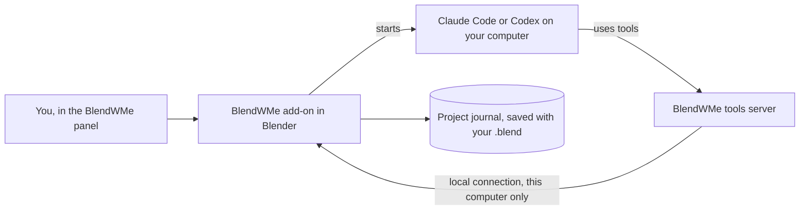

<p align="center">
  <picture>
    <source media="(prefers-color-scheme: dark)" srcset="assets/logo/blendwme-logo-blender-transparent.svg">
    
  </picture>
</p>

<p align="center"><b>A Blender artist and coach who sits inside your Blender and works with you.</b></p>

<p align="center">
  Blender 4.2 LTS and 5.x · Windows · Claude Code or Codex · MIT licence
</p>

## What is this & Why does it exist

Let's get one thing out of the way: I never made the donut. The only thing I ever tried to model in
Blender was a farmhouse, and that project never really got to where I wanted it to be. Blender's
capabilities are ridiculous, and that was exactly the problem. I found myself stuck in tutorial
hell, always having to search for a YouTube video to get any Blender project done.

I'm pretty good with other 3D modelling tools. Fusion 360 is the one I use most often, and
SolidWorks is where I started off. But I think those constructive CAD tools are more intuitive to
learn, because you usually build things up from simple shapes. Blender, however, seems to have been
made as a creative tool with a much greater horizon to aim for. Seriously, it's actually crazy what
it can do. The thing is, it feels "destructive", if I can say that, and that's the major difference
between it and the tools I mentioned. It made it much harder for me to change my way of thinking:
from putting squares and patterns together to make gearboxes, to moulding a shape I don't even know
exists yet from a circle. It's definitely a skill issue, and one I plan to fix.

When I ran into MCP for Blender, I was like, well, I'm cooked for sure now if AI can do this IN
BLENDER. I made a few prompts to see how far it could go, and it's pretty good. Claude is pretty
good. I want to be pretty good too! Please teach me your ways, Claude, teach me to be like you. And
as the master of all four elements, the Avatar if you will, Claude accepted. It accepted to
BlendWMe!

Okay, maybe I got carried away. But that's basically how the idea came about. Tutorial hell kept me
a beginner for as long as I've known Blender. So I wanted to make something that keeps me in the
app, actually doing stuff, making things and learning Blender inside out from an AI that is
without a doubt far ahead of me.

So that's what BlendWMe is: an experienced Blender artist that lives inside Blender. It can take
the wheel and build while you watch, or teach you one step at a time, and you can grab the wheel
back whenever you like. It runs on the Claude or ChatGPT plan you already pay for, through the
official Claude Code and Codex programs. No extra API bill sneaking up on you.

The trap, of course, is getting stuck in AI hell with Blender instead. Which is likely if it's used
the way vibe coding is used by people who only learned to code once a computer could do it 100x
better and faster than they ever will [I am people. People is in fact me]. But that's not how I intend to use this
tool. AI exists, and it probably won't go away any time soon. Zoomed out, it hasn't really come to
make things better for most of us, unless we try to use it that way. The creative space is the
biggest hater of AI, and with good reason. But BlendWMe is a tool I made for me, to keep up with the
fast-moving pace of a world with AI in it, in a way that keeps me in touch with the work I do. In my head, I plan to use it the
same way Tony Stark used Jarvis or Friday to help him be the Iron Man we all look up to: because at the end of the day, Tony was always Iron Man.
Not Jarvis, not Friday.

For the creatives: I feel the people who will get the most out of this tool are the ones who are the
most creative with it, and that's something neither I nor any AI can take away from you. So I hope
you use it in a way that gets the most out of you.

<!-- HERO: a 10 to 20 second GIF of Teach mode with the blinking block and radar ring. The maintainer records this. Path: docs/media/hero.gif -->

## Contents

- [What it does](#what-it-does)
- [How it works](#how-it-works)
- [Requirements](#requirements)
- [Install](#install)
- [Quick start](#quick-start)
- [Using BlendWMe](#using-blendwme)
- [Keyboard shortcuts](#keyboard-shortcuts)
- [Where things are saved](#where-things-are-saved)
- [Troubleshooting](#troubleshooting)
- [Limitations](#limitations)
- [Privacy and security](#privacy-and-security)
- [Project status and versions](#project-status-and-versions)
- [Contributing and feedback](#contributing-and-feedback)
- [Licence and credits](#licence-and-credits)

## What it does

There are two ways to work. Pick one with the tabs at the top of the panel, and switch whenever
you feel like it.

- **Auto.** It writes a plan, builds it part by part, and looks at the result from a few angles
  before calling anything done. The plan shows up as a checklist. Press **Pause** or **Take control**
  any time, move or reshape whatever you like, then **Resume**: it notices your changes and builds
  on your version instead of "fixing" it back.
  <!-- SCREENSHOT: Auto mode with the plan card. Path: docs/media/auto.png -->
- **Teach.** You drive, it coaches. One action at a time, under 20 words, with the "why" underneath
  for when you're curious. A blinking red block means "your move", a radar ring circles the tab or
  object to look at, and a pencil circle marks the part of the window. Press **Check my work** when
  you're done. Stuck? **Hint** gives you a nudge, **Skip this step** moves on (it remembers you
  haven't practised that one yet), and **Do it for me** does it while you watch. No judgement.
  Okay, a little.
  <!-- SCREENSHOT: Teach mode with the cue card and the radar ring on the Modifier tab. Path: docs/media/teach.png -->

(If you used 2.2: the old Together mode is now part of Auto. Pausing and taking over does the same
job without the AI stopping after every step.)

Two brains, one project:

- Use **Claude** (Claude Code on your Claude plan) or **Codex** (Codex CLI on your ChatGPT plan).
- When one of them hits its usage limit, **hand over** to the other. BlendWMe keeps a journal of the
  project (I call it "the baton"), so the next brain knows the brief, the plan, what you changed,
  what was giving the last one trouble, and what's left. Think of it as a shift change where
  someone actually left notes.

## How it works



When you send a message, the add-on starts Claude Code (`claude -p`) or Codex (`codex exec`) in a
workspace folder on your computer. The brain can only work through BlendWMe's tools: run a Python
step on the live scene, look at the viewport, read the scene, write a plan, teach a step, point at
a control. The tools server hands each call to Blender over a local connection, and Blender runs it
with its own undo step. Before each step Blender also saves a backup copy of the scene, so a step
that goes wrong can be put back. Every step and every hand-over goes into the project journal.

You sign in inside Claude Code and Codex themselves. BlendWMe never sees your login. Everything runs
on your computer except the AI's thinking.

## Requirements

| You need | Notes |
|---|---|
| Blender 4.2 LTS or newer | 2.3 is tested with 5.2.2. 2.2 was also tested with 4.2.3. |
| Windows 10 or 11 | Tested on Windows 11. macOS and Linux are untested (brave souls welcome). |
| Claude Code, signed in with a Claude plan **or** Codex CLI, signed in with a ChatGPT plan | One is enough. Both lets you use the relay. Claude Code needs a Pro, Max, Team or Enterprise plan. |
| Python 3.10 or newer for the tools server | Optional. BlendWMe installs the tools server into its own environment with any Python it finds, or with Blender's own Python. It needs the internet once to download the `mcp` package. |

## Install

1. **Install Claude Code and sign in.** Open PowerShell and run the official installer
   ([docs](https://code.claude.com/docs/en/setup)):

   ```powershell
   irm https://claude.ai/install.ps1 | iex
   ```

   Open a new terminal, run `claude`, and follow the browser prompts to sign in with your Claude plan.
2. **(Optional) Install Codex CLI and sign in.** In PowerShell
   ([official README](https://github.com/openai/codex)):

   ```powershell
   powershell -ExecutionPolicy ByPass -c "irm https://chatgpt.com/codex/install.ps1 | iex"
   ```

   Or, if you have Node.js: `npm install -g @openai/codex`. Then run `codex` and choose
   **Sign in with ChatGPT**.
3. Download `blendwme-2.3.0.zip` from [Releases](../../releases). Don't unzip it. Blender wants
   the zip.
4. In Blender: **Edit > Preferences > Get Extensions**, open the drop-down menu in the top right,
   choose **Install from Disk**, and pick the zip.
5. **Save Preferences** (the menu at the bottom left of the Preferences window > Save Preferences).
   Skip this and Blender forgets BlendWMe the next time it starts. Ask me how I know.
6. Open BlendWMe: press **Ctrl+Alt+M** with the mouse over the 3D Viewport, or click the
   **BlendWMe** button in the viewport's header (top right, next to the overlays).
7. Click **Settings** at the bottom of the panel. The checks run by themselves. If the tools server
   is missing, press **Install the tools server**. You want a ✓ on every line.

<details>
<summary><b>Make Blender find Claude Code and Codex</b></summary>

Blender started from the Start menu doesn't always see the same PATH as your terminal. BlendWMe
looks for `claude` on the PATH and in `%USERPROFILE%\.local\bin`, where the official installer puts
it. If the check still can't find a program:

1. Open a terminal and run `where claude` (or `where codex`). Copy the path it prints.
2. In BlendWMe: **Settings > Advanced**. Paste the path into **Claude Code program** (or
   **Codex program**).
3. Run the checks again.

</details>

<details>
<summary><b>Upgrading</b></summary>

Install the new zip the same way (Install from Disk). It replaces the old version. Restart Blender.
Your journal, logs and settings stay where they are.

</details>

## Quick start

1. Open BlendWMe (**Ctrl+Alt+M**). You get one input, three example ideas and the mode tabs.
2. Stay on **Auto**. Type `Model me a simple ice cream cone`, press **Enter**, lean back, and watch
   the plan tick off.
3. Press **New task** at the bottom of the panel and try `Make a cosy cottage with a red tiled roof`.
   Halfway through, press **Pause**, move or reshape something yourself, then **Resume**. BlendWMe
   notices and keeps your change. Yes, even if your chimney is crooked. It's *your* chimney.
4. Switch to **Teach** and type `Teach me to bevel the table edges` (on a scene with a table or a
   box). Follow the card and press **Check my work** when you've done it.

## Using BlendWMe

### Modes

| Mode | Who does the work | Try saying |
|---|---|---|
| Auto | The AI, part by part, checking as it goes. You can pause and take over any time | `A cosy low poly cottage with a stone base and a small path` |
| Teach | You, guided one action at a time | `Teach me to bevel the table edges` |

Done with one thing and starting another? Press **New task** (in Teach: **New lesson**) at the
bottom of the panel, or type `/new`. It starts fresh and leaves your scene alone. The journal keeps
the old task in its history.

Got a reference picture? Add it in Settings > **References for this task** before you send the
brief. BlendWMe shows it to the brain and checks the build against it.

Camera giving you grief? Ask "How do I aim the camera at my scene?" in Teach for a short lesson
with pointers, or press **Do it for me** and it lines the camera up with your view, frames the scene
or sets the lens.

<details>
<summary><b>The tools the brains use</b></summary>

| Tool | What it's for |
|---|---|
| `run_python` | Run one Python step on the live scene, with an undo step and a backup copy. A failed step is rolled back |
| `look` | Pictures of the scene: several angles, the viewport, or through the camera |
| `get_scene_info`, `get_object_info` | Exact facts: sizes, positions, modifiers, materials |
| `plan` | The build checklist, and marking parts done or skipped with a reason |
| `teach_step` | One action for you to do, with a pointer, and a check that sees when it's done |
| `point_at` | A radar ring or pencil circle on an object, a tab or a part of the window |
| `ask_user` | A short question when a wrong guess would waste work |
| `load_skill`, `inspect_api` | Technique cards and Blender API lookups |
| `finish` | End the task. Refused while plan parts are still open, before a fresh look at the result, or after a "needs work" review |
| `handoff_note`, `read_journal` | The baton between Claude and Codex |

</details>

### The panel: move it, shrink it, tuck it away

The panel sits in the top right of the viewport, next to the navigation gizmo (never on top of it),
and is only as tall as what it has to show. If it's still in the way:

- **Move it.** Drag the logo row anywhere, in any direction. It snaps to the edges and corners of
  the viewport; hold **Ctrl** to place it freely, press **Esc** to put it back mid-drag. It remembers
  the nearest corner, so it stays put when you open the sidebar or resize the window.
- **Resize it.** Drag the little grip in the opposite corner. Double-click the grip for the normal
  size.
- **Three views.** Double-click the logo row for **Compact** (just what's happening, the buttons and
  the input). The square button makes the panel full height, or opens Full from Compact. The line
  button folds it into a small bar: the AI keeps working, the bar shows what it's doing, and it
  blinks when it's your turn. **Take control** folds it for you, because if you're taking over, you
  probably want to see what you're doing. On a small screen the panel goes Compact by itself.
- **Size things to taste.** Settings > Panel has **Panel size** (everything at once), **Text size**
  and **Icon size**. The default is 75 %, on top of Blender's own Resolution Scale.
- **Put the panel back on the right** in Settings > Panel undoes all your moving and resizing.

Typing works like a Blender text field: Shift+arrows select, Ctrl+arrows jump words, Ctrl+C / X / V,
Ctrl+Z / Ctrl+Shift+Z. Click to put the caret where you want it.

### Reading long answers

Replies show **bold**, bullet lists and `code`. Long ones fold behind **Read more**, and **Full
text** at the bottom of the panel opens a reader with the whole conversation. **Draft** opens the
message you're typing. In the reader you can scroll, select with the mouse, Ctrl+A to select all,
Ctrl+C to copy, and Shift+Ctrl+C to copy the original text with its formatting marks.

### The plan

In Auto the brain writes a plan first. Each part ticks off when it's built. A part can also be
marked done after the brain has actually looked at it, or skipped with a reason you can read. A
step that changed nothing doesn't tick anything off. The task can only finish when every part is
settled and the brain has taken a fresh look at the finished result. If the art director review
says the work still needs work, it has to fix it first. So no more "Done! ✓" with half the house
missing. A finished, stopped or new task closes the plan card.

### Pausing and taking control

**Pause** (or **Esc**) stops the AI before its next action. Move, edit or delete anything you like,
then press **Resume**. The AI is told what you changed and keeps it, even if you renamed things.
**Esc** twice stops the task. Everything already built stays in your scene, and **Undo step**
removes the last AI step.

Your own work is protected: when the AI changes one of your materials or a mesh that other objects
share, it works on a copy, and when it rebuilds its own parts it keeps anything you attached to
them. Very heavy geometry and runaway scripts are stopped before they freeze Blender.

### Hand over (the relay)

The brain card has a **Hand over** button. The working brain writes a short handoff note, then the
other brain starts with the journal brief and a fresh look at the scene. When a brain hits its usage
limit, a card offers the hand-over. In Auto, BlendWMe can hand over by itself (Settings > Relay and
pace).

### The journal

Open it from the panel footer (**Journal**). It shows the brief, every step signed by whoever made
it, the hand-overs, who made which objects, the problems (open and solved), and what's next.
**Open as Blender text** shows the raw journal; **Export** saves a copy to the logs folder.

The journal follows the file you saved. Save, let the AI build more, close without saving, reopen:
it remembers the saved version, not the work you threw away. It also notices when a reference
picture has moved or gone missing.

### Themes

Settings > Theme has five:

| Theme | Looks like |
|---|---|
| **Graphite** | White paper and pencil. Red only when it's your turn |
| **Red** | Red on paper. Bold and warm |
| **Blender Grey** | Blender's own dark grey, for people who think white panels are an attack |
| **2000s** | Made for Blender's **Theme 2000**: Luna blue title bar, navy shadow, orange when it's your turn |
| **Blender UI** | No drawn panel at all. See below |

Animations follow your system's "reduce motion" setting and Blender's **Smooth View** (set it to 0
and the panel stops animating too). You can force them on or off in Settings > Advanced.

### Blender UI mode

Pick the **Blender UI** theme and BlendWMe drops its own panel and moves into the sidebar (**N** >
**BlendWMe** tab), built from Blender's normal buttons like any other add-on. Same modes, same
brains, same journal, same hand-over: the status, the card for your turn, the plan, the conversation
and the settings, all in Blender's look and your Blender theme. Typing uses Blender's own text field,
so input methods for other languages work there too.

The pointers in the viewport stay (radar rings, pencil circles, notes), drawn in your theme's
colours. **Ctrl+Alt+M** and the header button open and close the sidebar tab. Switch back to any
other theme and the floating panel returns where you left it.

## Keyboard shortcuts

| Key | Action |
|---|---|
| Ctrl+Alt+M | Open BlendWMe (mouse over a 3D Viewport). Press again: focus the input. Again: minimize. In Blender UI mode: show or hide the sidebar tab |
| Enter | Send |
| Shift+Enter | New line |
| Esc | Pause the AI while it works. Otherwise close the top card |
| Esc twice | Stop |
| Up / Down | Previous / next message you sent |
| Shift+Tab | Next mode: Auto, Teach |
| Ctrl+L | Clear the conversation view (the journal keeps everything) |
| `/` | Commands: `/handover`, `/look`, `/undo`, `/journal`, `/logs`, `/settings`, `/new`, `/stop`, `/help` |
| `?` | Show all shortcuts (in an empty input) |

Blender already uses most of these keys somewhere else, so they only act while the BlendWMe panel
has focus. Esc while the AI works also pauses it from the viewport, except while an animation plays.
Change the keys in **Edit > Preferences > Keymap > Window**: "BlendWMe" (the one that opens it)
and the "BlendWMe Panel Key" items.

## Where things are saved

| What | Where |
|---|---|
| Project journal | Inside the .blend as the Text block `BlendWMe Journal`, and as `<file name>_blendwme\journal.json` next to the .blend |
| BlendWMe logs | `Documents\BlendWMe Logs`: `session_*.log`, one log per task, `python-crash-trace.txt` and crash reports |
| Workspace for Claude Code and Codex | `Documents\BlendWMe Workspace`: their instructions, the tools server settings and its Python environment |
| Blender crash log (Windows) | `%TEMP%\blender.crash.txt` |

Type `/logs` in the panel, or use Settings > Advanced > **Open Logs Folder**. Both folders can be
changed in Settings > Advanced.

## Troubleshooting

| Problem | Fix |
|---|---|
| BlendWMe vanished after Blender crashed | Enable it again in Preferences > Add-ons, then **Save Preferences**. BlendWMe's Settings remind you while preferences are unsaved |
| The panel is in the way | Double-click the logo row for Compact, fold it into the bar (line button), drag it somewhere else, shrink it in Settings > Panel, or switch to the **Blender UI** theme |
| "Claude is not signed in" or "Codex is not signed in" | Open a terminal, run `claude` or `codex`, and sign in. Then run the checks again |
| A program is not found | See [Make Blender find Claude Code and Codex](#install) |
| "Claude's limit is reached" | Press **Hand over to Codex**, or wait for the reset time shown on the card |
| The tools server check fails | Settings > **Install the tools server**. It needs the internet once |
| The AI's result looks wrong | **Undo step**, or ask it to look again (`/look`) and fix it. Or pause and fix it yourself; it keeps your version |
| Blender crashed | Settings > Advanced > **Make Crash Report**. It zips BlendWMe's latest logs, the Python crash trace and Blender's crash log. For a detailed run, start `blender_debug_log.cmd` from the Blender install folder and repeat the steps |

## Limitations

> [!WARNING]
> The AI runs Python in your Blender. Save your work often. Every AI step has its own undo step and
> a backup copy, and a failed step is rolled back, but a wrong step can still change your scene.

Honest list, because you'll find out anyway:

- The AI makes mistakes. It's good at scenes and props. Complex characters, rigging, simulation and
  detailed sculpting are still weak, and that's where most of my work is going next.
- It uses your plan's usage limits. Long Auto sessions eat them faster.
- It needs an internet connection for the AI.
- Version 2.3 is tested on Blender 5.2.2 and Windows 11 only (2.2 also ran on 4.2.3 LTS).
- Version 2.3 was tested end to end with stand-in programs in place of Claude Code and Codex (the
  real tools server, the real Blender, the real journal). Full runs on real Claude and ChatGPT
  accounts are in progress. Codex's command-line flags follow its official documentation.
- Only four technique cards are switched on for now: the cottage, the room, the ice cream cone and
  camera help. The others stay off until their steps have been tested in Blender.
- The backup copy before each step costs a moment on big scenes. It hasn't been measured on very
  large files yet.
- Teach pointers to the Properties tabs mark the tab column, not one exact button.
- Some laptops have no numpad. Teach steps that use numpad keys also give the menu path.
- Not affiliated with Blender, Anthropic or OpenAI. Just a fan of all three.

## Privacy and security

- BlendWMe stores no passwords, API keys or logins. It removes API-key environment variables before
  starting Claude Code or Codex, so they always use your plan sign-in.
- The tools server only talks to Blender on this computer (`127.0.0.1`), with a random token that
  changes every time Blender starts.
- Claude Code runs with its own built-in tools turned off; only BlendWMe's tools are allowed.
  Codex runs in a read-only sandbox.
- What the AI receives: your messages, scene information, and the viewport pictures it asks for.
- No telemetry. The journal and the logs stay on your computer.

## Project status and versions

- Current version: **2.3.0**. See [CHANGELOG.md](CHANGELOG.md).
- Branches: `main` (this version), `v2.0.0-full` (2.0.0, which also had a pay-per-token API engine),
  `nebius-nemotron` (the original Nemotron build from the Nebius x NVIDIA hackathon, where this all
  started).
- What's next:
  - A character pipeline: references, blockout, refinement, materials, rig and pose.
  - Measured checks against your reference image (silhouette comparison), so "looks like the
    reference" becomes a number, not a vibe.
  - More tested technique cards: sculpting, animation, Grease Pencil, geometry nodes.
  - Teaching replay: turn a finished build into a lesson you can follow.

## Contributing and feedback

Found a bug? Open an [Issue](../../issues). It helps a lot if you attach:

1. The crash report zip (Settings > Advanced > Make Crash Report), or the newest
   `session_*.log` from the logs folder.
2. Your Blender version and Windows version.
3. What you did before it broke, and which brain and mode you were using.

Ideas and "it would be cool if" messages are welcome too.

## Licence and credits

- BlendWMe is released under the [MIT licence](BlendWMe-Source/blendwme/LICENSE).
- [MCP for Blender](https://github.com/ahujasid/mcp-for-blender) by Siddharth Ahuja (MIT licence)
  for the local socket pattern and the viewport capture technique. Its notice is in
  [LICENSE-THIRD-PARTY](BlendWMe-Source/blendwme/LICENSE-THIRD-PARTY).
- Fonts: Archivo and Archivo Black (Omnibus-Type) and Patrick Hand (Patrick Wagesreiter), SIL Open
  Font License 1.1.
- Blender is a registered trademark of the Blender Foundation. Claude and Claude Code are trademarks
  of Anthropic. ChatGPT and Codex are trademarks of OpenAI. BlendWMe is an independent project and
  is not affiliated with or endorsed by them.
- Made by [definitelynotironman](https://github.com/definitelynotironman), whose farmhouse is
  still not finished.
