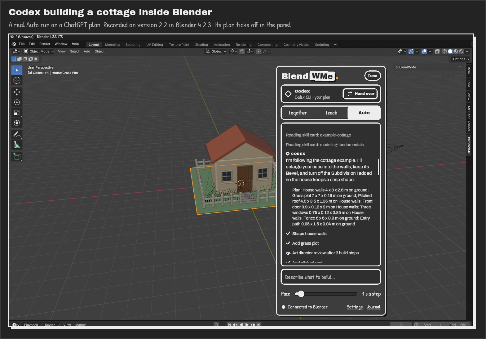
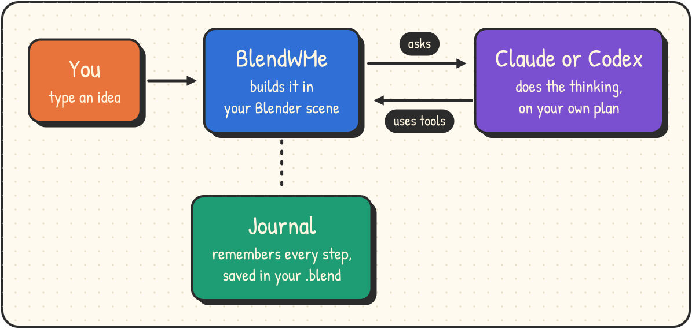
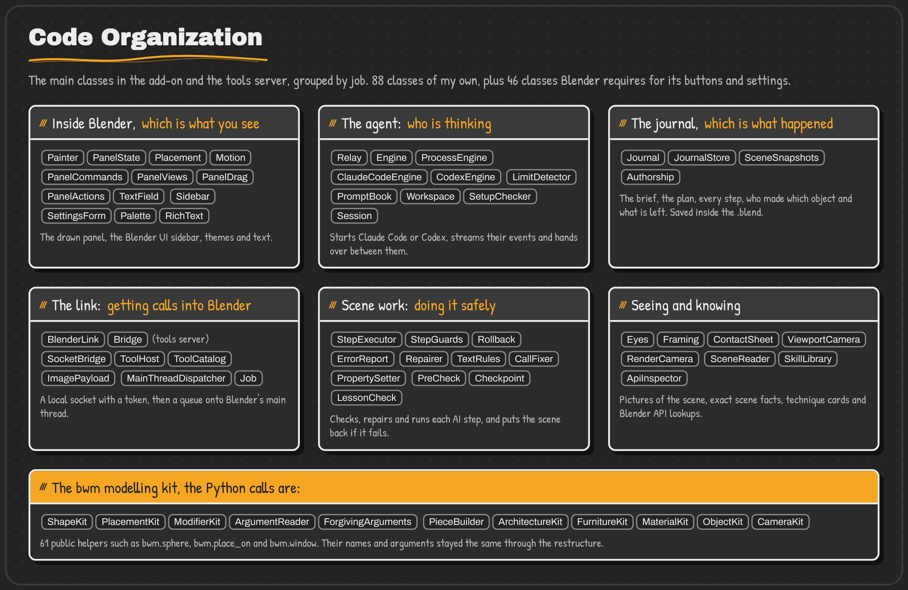
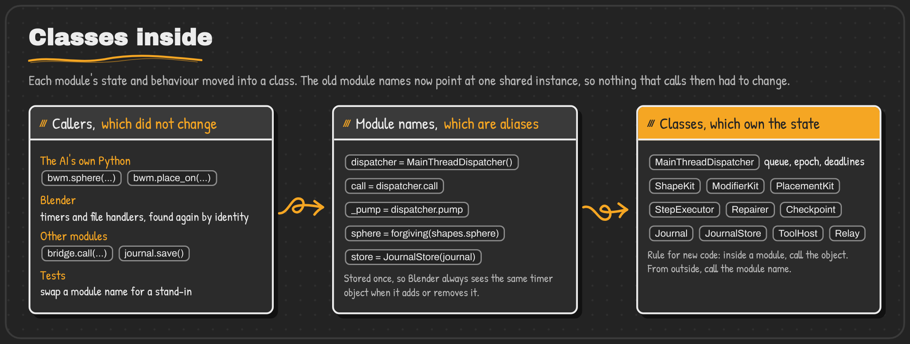
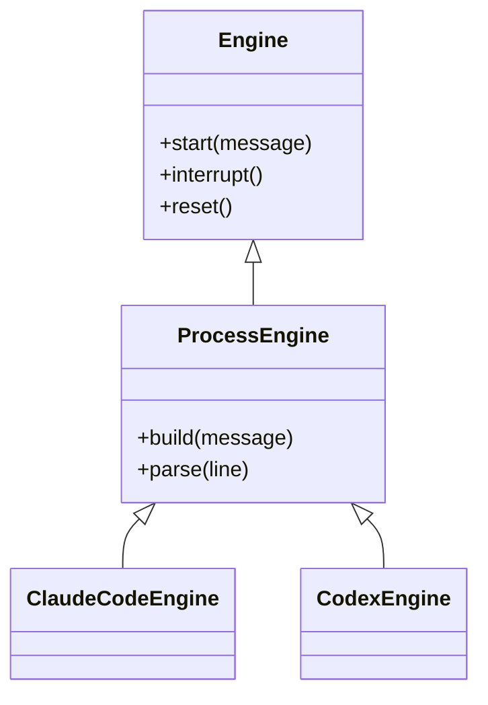
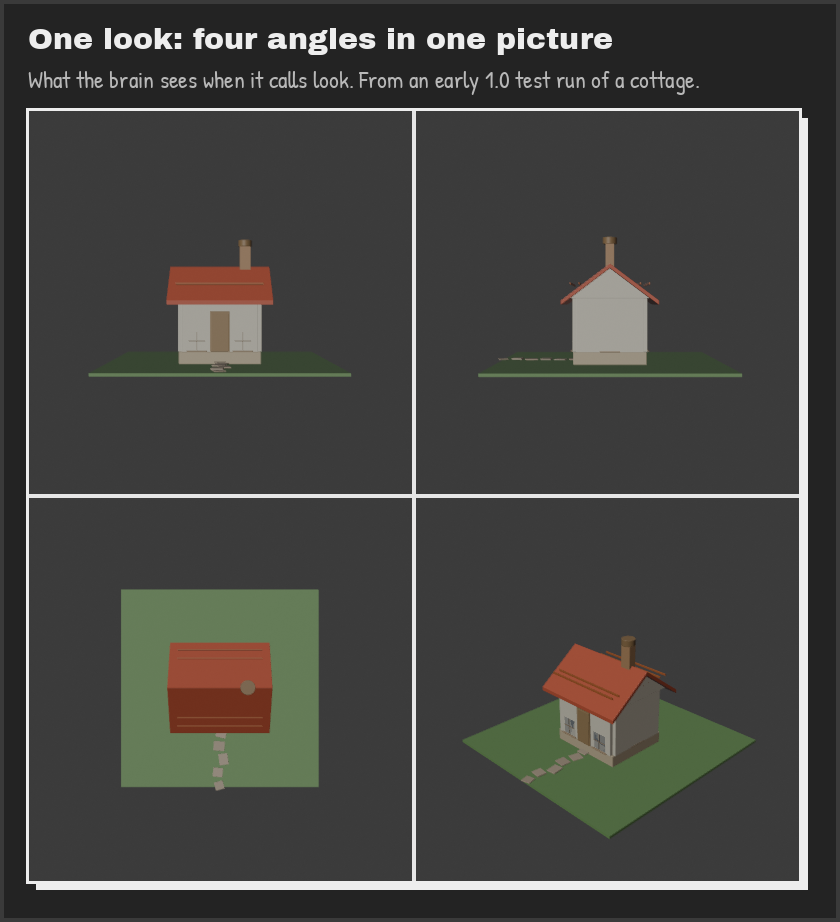
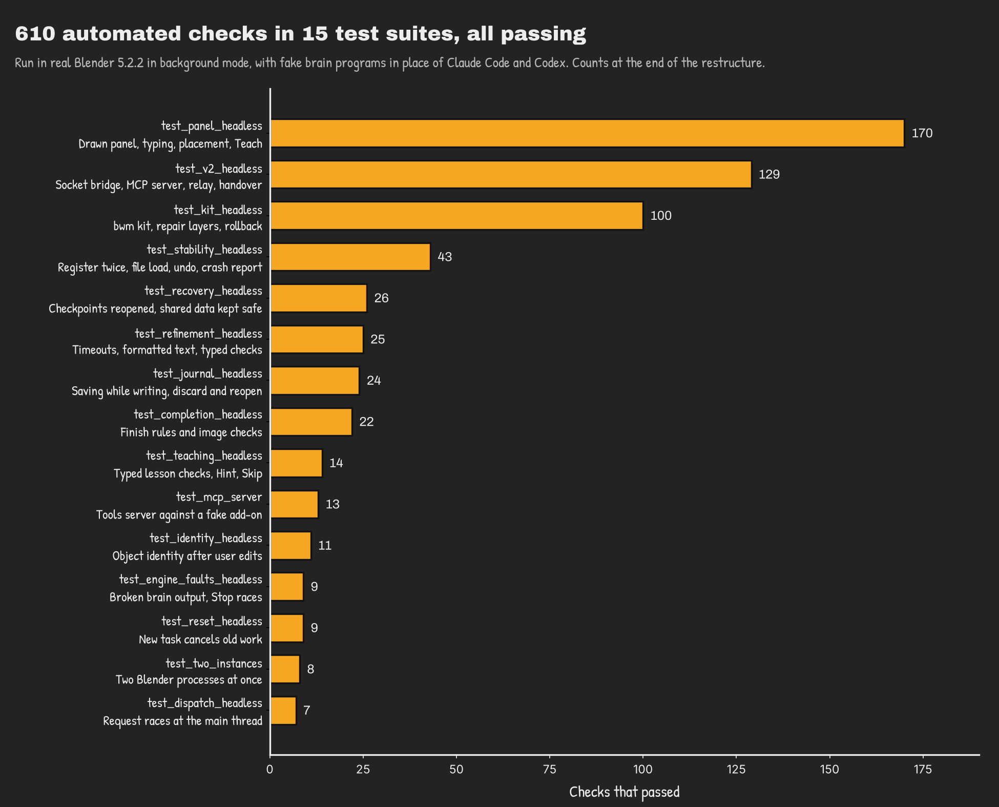
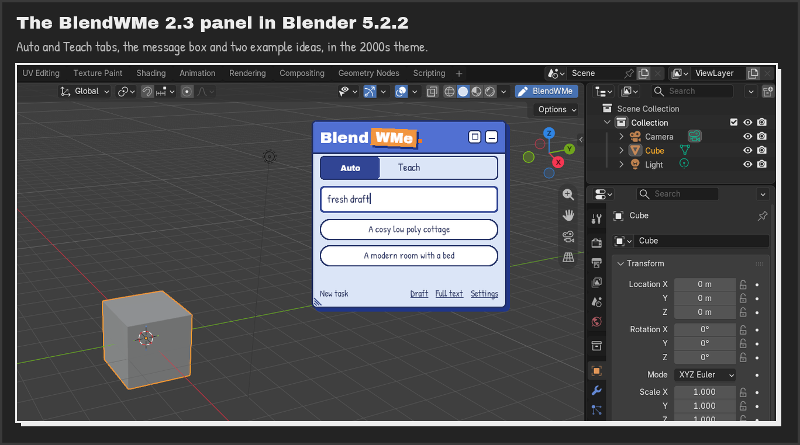
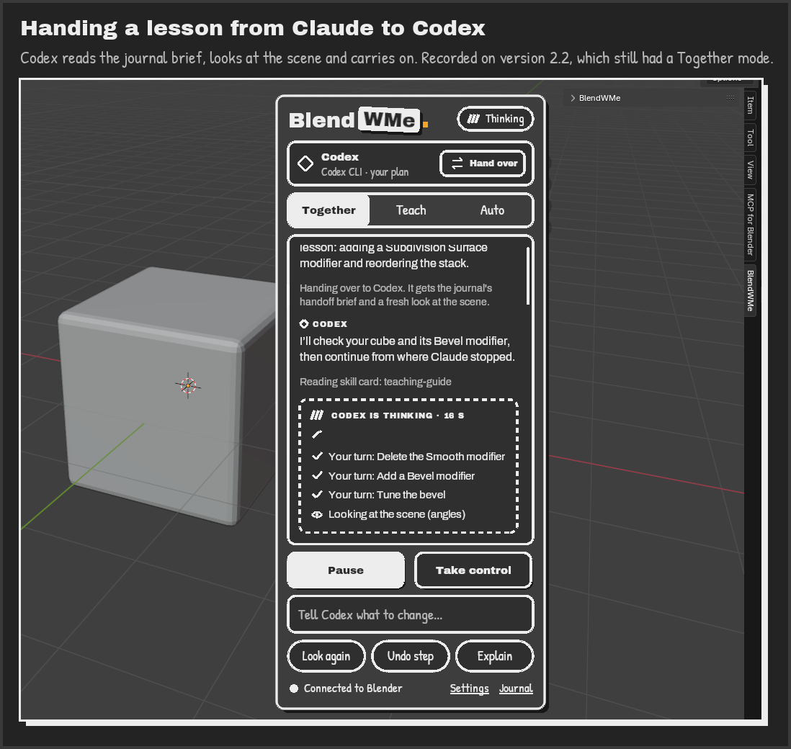

<p align="center">
  <picture>
    <source media="(prefers-color-scheme: dark)" srcset="assets/logo/blendwme-logo-blender-transparent.svg">
    
  </picture>
</p>

<p align="center"><b>Built in Blender teaching AI</b></p>

<p align="center">
  <picture><source media="(prefers-color-scheme: dark)" srcset="assets/readme/badges/python-dark.svg"></picture>
  <picture><source media="(prefers-color-scheme: dark)" srcset="assets/readme/badges/blender-dark.svg"></picture>
  <picture><source media="(prefers-color-scheme: dark)" srcset="assets/readme/badges/brains-dark.svg"></picture>
  <picture><source media="(prefers-color-scheme: dark)" srcset="assets/readme/badges/version-dark.svg"></picture>
  <picture><source media="(prefers-color-scheme: dark)" srcset="assets/readme/badges/licence-dark.svg"></picture>
</p>

## Why though?

The only thing I ever tried to model in Blender was a farmhouse, and that project never really got to where I wanted it to be. Blender's
capabilities are ridiculous, and that is kinda a problem.I have too much going on to learn it in nearly as much detail to deem myself confident. I found myself stuck in tutorial
hell, always having to search for a YouTube video to get any Blender project done.

It's not eve that i can't 3D model, I'm pretty good with other 3D modelling tools. Fusion 360 is the one I use most often, and
SolidWorks is where I started off. But I think those constructive CAD tools are more intuitive to
learn, because you usually build things up from simple shapes. Blender, however, seems to have been
made as a creative tool with a much further horizon as a target. Seriously, it's actually crazy what
it can do. It feels "destructive", if I can say that, and that's the major difference
between it and the tools I have learned. It made it much harder for me to change my way of thinking:
from putting squares and patterns together to make gearboxes, to moulding a shape I don't even know
exists yet from a circle. It's definitely a skill issue, and one I plan to fix.

When I ran into MCP for Blender, I was like, well, I'm cooked for sure now if AI can do this IN
BLENDER. I made a few prompts to see how far it could go, and it's pretty good. Claude is pretty
good. I want to be pretty good too! Please teach me your ways, Claude, teach me to be like you. And
as the master of all four elements, the Avatar if you will, Claude accepted. It accepted to
BlendWMe!

Okay, maybe I got carried away. But that's basically how the idea came about. Tutorial hell kept me
a beginner for as long as I've known Blender. So I wanted to make something that keeps me in the
app, actually doing stuff, making things and learning Blender inside out from an AI that is
without a doubt far ahead of me.

So that's what BlendWMe is: an experienced Blender artist that lives inside Blender. It can take
the wheel and build while you watch, or teach you one step at a time, and you can grab the wheel
back whenever you like. It runs on the Claude or ChatGPT plan you already pay for, through the
official Claude Code and Codex programs. No extra API bill sneaking up on you.

The trap, of course, is getting stuck in AI hell with Blender instead. Which is likely if it's used
the way vibe coding is used by people who only learned to code in the time a computer could do it 100x
better and faster than they ever will [I am people. People is in fact me]. But that's not how I intend to use this
tool. AI exists, and it probably won't go away any time soon. Zoomed out, it hasn't really come to
make things better for most of us, unless we try to use it that way. The creative space is the
biggest hater of AI, and with good reason. But BlendWMe is a tool I made for me, to keep up with the
fast-moving pace of a world with AI in it, in a way that keeps me in touch with the work I do. In my head, I plan to use it the
same way Tony Stark used Jarvis or Friday to help him be the Iron Man we all look up to: because at the end of the day, Tony was always Iron Man.
Not Jarvis, not Friday.

For the creatives: I feel the people who will get the most out of this tool are the ones who are the
most creative with it, and that's something neither I nor any AI can take away from you. So I hope
you use it in a way that gets the most out of you.

<p align="center">
  
</p>

## The project at a glance

I built BlendWMe on my own in October 2026. It is a Blender add-on written in Python. For version 2.3.0 I rebuilt the code around classes. The table shows the code before (2.2.0) and after (2.3.0).

| Add-on and tools server | 2.2.0, before | 2.3.0, after |
|---|---:|---:|
| Classes I designed | 28 | 88 |
| Functions left loose in files | 493 | 203 |
| Functions and classes with a short description | 40 % | 100 % |
| Lines of Python | 14,100 | 17,476 |
| Public `bwm` names that changed | | 0 of 61 |
| Automated checks passing | | 610 |

**Terms used in this README**

- <sub><i><b>Brain:</b> the AI doing the thinking. This is Claude Code or Codex.</i></sub>
- <sub><i><b>MCP:</b> the standard way an AI program uses outside tools.</i></sub>
- <sub><i><b>bwm:</b> my set of modelling helpers that the AI's code calls, like <code>bwm.sphere</code>.</i></sub>
- <sub><i><b>Main thread:</b> the only part of Blender that is allowed to change the scene.</i></sub>
- <sub><i><b>Journal:</b> the project's memory, saved inside the .blend file.</i></sub>

## Contents

1. [What it does](#what-it-does)
2. [How it works](#how-it-works)
3. [How the code is organised](#how-the-code-is-organised)
4. [Keeping your scene safe](#keeping-your-scene-safe)
5. [Testing](#testing)
6. [Results](#results)
7. [What did not work](#what-did-not-work)
8. [Limits and next steps](#limits-and-next-steps)
9. [Repo structure](#repo-structure)
10. [Install and run](#install-and-run)
11. [Using BlendWMe](#using-blendwme)
12. [Privacy](#privacy)
13. [Credits and licence](#credits-and-licence)

## What it does

BlendWMe has two modes.

- **Auto.** The AI makes a plan and builds it one part at a time. It looks at the result before it says it is done. You can pause it, change things yourself and let it carry on from your version.
- **Teach.** You do the work and the AI coaches you. It gives one short step at a time and points at the real button in Blender. Press **Check my work** when you are done.

You can use Claude Code or Codex. If one runs out of usage, you can hand the project to the other. The journal tells the new one what has been done and what is left.

## How it works

<p align="center">
  
</p>

When you send a message, BlendWMe starts Claude Code or Codex on your computer. The AI can only use BlendWMe's tools. It can run a small piece of Python on the scene, take pictures of the scene, read the scene, write a plan or point at a button.

Each tool call travels over a private connection on your computer to Blender. Blender runs it and saves an undo step and a backup first. Every step is written into the journal.

## How the code is organised

This is the main technical part of the project. Before 2.3, the code was loose functions sharing global values across 40 files. It was hard to tell which code owned which data. In 2.3 I grouped the code into classes. Each class owns its own data and the functions that change it.

### The class map

<p align="center">
  
</p>

I split big files by job, not by size. For example, the panel became four classes. `PanelState` remembers things between redraws, `Painter` draws one frame, `Placement` decides where the panel sits and `Motion` handles its animation.

### Classes inside, old names outside

A lot of code already used the old names. The AI's own Python calls `bwm.sphere(...)`. Blender needs the exact same timer object every time. The tests swap old names for fake versions. Renaming anything would break all of that.

So I kept every old name and pointed it at one shared object.

<p align="center">
  
</p>

```python
dispatcher = MainThreadDispatcher()   # one shared object
call = dispatcher.call                # the old name still works
```

To prove nothing broke, I printed all 61 `bwm` names and their inputs inside Blender before and after the change. They are the same.

### One parent class, two brains

Claude Code and Codex are different programs. The rest of BlendWMe should not care which one is running. So both are child classes of one parent class. This is called inheritance.



`ProcessEngine` does the shared work. It starts the program, reads its output line by line and handles Stop. Each child only says how to start its program (`build`) and how to read its output (`parse`). Adding a third brain would mean one new child class with two functions.

I used the same idea for furniture. `PieceBuilder` is the parent, and `ArchitectureKit` and `FurnitureKit` are its children. So a door and a bed are built and placed the same way.

### Building objects from smaller parts

Most classes are made from smaller parts that are passed in.

```python
executor = StepExecutor(StepGuards(), Rollback(), ErrorReport())
```

`StepGuards` decides what may run and for how long. `Rollback` undoes a failed step. `ErrorReport` explains an error to the AI. `StepExecutor` only decides the order. Small parts are easier to test, because a test can swap one for a fake.

### Keeping data and saving apart

`Journal` only holds the data, like the plan, the steps and the notes. `JournalStore` only saves and loads it. This split helped me fix a real bug. If a new step arrived while the journal was saving, that step could be lost. Now each change gets a number, and the store only marks the journal as saved if the number did not change while it was writing.

### Where I did not use classes

| Area | Why it stays as plain functions |
|---|---|
| Drawing helpers | Blender's drawing settings are global. A class would add nothing. |
| Blender timers and handlers | Blender needs the exact same object each time it adds or removes one. |
| Small helpers | They take a value and give one back. They hold no data. |
| Test files | Blender runs them as scripts. Their fake parts are classes. |

## Keeping your scene safe

The AI's code runs inside your open Blender project, so safety matters most.

- **One queue.** The AI thinks in the background, but only Blender's main thread may change the scene. Every change waits in a queue. If you start a new task or open another file, old changes in the queue are thrown away.
- **A backup before every step.** Blender saves an undo step and a backup copy first. If a step fails, the scene is put back.
- **Time and size limits.** A step stops after 15 seconds, and very heavy shapes are refused before they are made. This stops Blender from freezing.
- **Small fixes, not rejections.** The AI often uses old Blender names or guesses a setting. BlendWMe fixes small slips and tells the AI the right name. If it cannot tell what was meant, it refuses and lists the real options.
- **Proof before "done".** In Auto, the AI cannot finish until every part of the plan is done and it has looked at the finished scene.
- **Teach checks never run code.** A lesson check only reads simple facts, like which object is selected. It never changes your scene.

<p align="center">
  
</p>

## Testing

<p align="center">
  
</p>

The tests run inside real Blender with no window. They do not use a real AI. A small fake program plays the part of Claude Code or Codex, so the whole path from the AI to the scene is tested. Tricky timing problems are tested on purpose by holding a step back and then changing the task at an exact moment.

## Results

<p align="center">
  
</p>

Version 2.3.0 has two modes, two brains with handover, a journal saved in the .blend and a panel inside Blender. All 610 checks pass, and every function and class has a short description.

<p align="center">
  
</p>

Above, Claude was teaching a lesson and handed it to Codex. Codex read the journal, looked at the scene and carried on from the same step.

## What did not work

| What I tried | What happened |
|---|---|
| Version 1 used one AI model paid per use (Nemotron 3 Ultra on Nebius) | Only 8 of 19 test builds finished. Version 2 moved to Claude Code and Codex on plans people already pay for. |
| A third "Together" mode | It overlapped with Auto. It became Pause and Resume inside Auto. |
| Teach checks written as Python by the AI | They could change the scene. They became simple read-only facts. |
| Quietly ignoring unknown settings | The AI thought wrong builds had worked. Now it gets a clear error. |
| Saving only part of the scene as a backup | It reopened empty. The backup is now a full copy of the file. |

## Limits and next steps

The AI still makes mistakes. It is good at scenes and props, but weak at characters, rigging and sculpting. Only four technique cards are switched on for now. I have only tested on Windows 11 with Blender 5.2.2. Full runs on real Claude and ChatGPT accounts are still in progress.

Next, I want to build characters step by step, from reference pictures to a posed model. I also want to measure how close a build is to the reference picture.

## Repo structure

```text
BlendWMe/
├── BlendWMe-Source/
│   ├── blendwme/          # the Blender add-on
│   │   ├── engines/       # Claude Code and Codex
│   │   ├── skills/        # technique cards the AI can read
│   │   └── *.py           # panel, journal, tools, safety and the bwm kit
│   ├── blendwme_mcp/      # the tools server the AI talks to
│   ├── tests/             # 16 test files and the fake AI
│   └── tools/package.py   # builds the install zip
├── assets/                # logos and README pictures
├── CHANGELOG.md
└── README.md
```

## Install and run

You need Windows 10 or 11, Blender 4.2 or newer, and Claude Code (Claude plan) or Codex (ChatGPT plan). One is enough. Having both lets you hand over.

```powershell
# Install Claude Code, then run `claude` once to sign in
irm https://claude.ai/install.ps1 | iex

# Optional: install Codex, then run `codex` and choose Sign in with ChatGPT
powershell -ExecutionPolicy ByPass -c "irm https://chatgpt.com/codex/install.ps1 | iex"
```

1. Download `blendwme-2.3.0.zip` from [Releases](../../releases). Do not unzip it.
2. In Blender, open **Edit > Preferences > Get Extensions**, use the menu at the top right, choose **Install from Disk** and pick the zip.
3. Press **Save Preferences**, or Blender forgets BlendWMe next time.
4. Click the **BlendWMe** button at the top of the 3D Viewport, then **Settings**. If the tools server is missing, press **Install the tools server**.

Try it with `Model me a simple ice cream cone` in Auto, or `Teach me to bevel the table edges` in Teach.

<details>
<summary><b>Build and test from source</b></summary>

```powershell
cd BlendWMe-Source
python tools/package.py      # makes dist/blendwme-<version>.zip
blender -b --factory-startup --python-exit-code 1 --python tests/test_kit_headless.py
```

</details>

<details>
<summary><b>Blender cannot find Claude Code or Codex</b></summary>

Run `where claude` (or `where codex`) in a terminal and copy the path. Paste it into **Settings > Advanced > Claude Code program** (or **Codex program**) and run the checks again.

</details>

## Using BlendWMe

- Press **New task** or type `/new` to start fresh. Your scene stays as it is.
- Press **Add pictures** (the paperclip) to give the AI up to 8 reference pictures.
- Drag the logo row to move the panel. Double-click it for a smaller view.
- **Settings > Theme** has five looks. **Blender UI** moves BlendWMe into Blender's own sidebar (**N > BlendWMe**).
- Open the **Journal** from the bottom of the panel to see every step.

<details>
<summary><b>Keyboard shortcuts</b></summary>

| Key | Action |
|---|---|
| Enter | Send |
| Shift+Enter | New line |
| Esc | Pause the AI, or close the top card |
| Esc twice | Stop |
| Up / Down | Your earlier messages |
| Shift+Tab | Switch mode |
| `/` | Commands like `/new`, `/look`, `/undo` and `/help` |

The keys only work while the BlendWMe panel is active.

</details>

<details>
<summary><b>Where things are saved</b></summary>

| What | Where |
|---|---|
| Journal | Inside the .blend, and as a `journal.json` next to it |
| Logs | `Documents\BlendWMe Logs` |
| AI workspace | `Documents\BlendWMe Workspace` |

</details>

<details>
<summary><b>Troubleshooting</b></summary>

| Problem | Fix |
|---|---|
| BlendWMe vanished after a crash | Turn it on again in Preferences > Add-ons and press **Save Preferences** |
| "Not signed in" | Run `claude` or `codex` in a terminal and sign in |
| "Limit is reached" | Press **Hand over**, or wait for the reset time |
| The result looks wrong | Press **Undo step**, or pause and fix it yourself |
| Blender crashed | Use **Settings > Advanced > Make Crash Report** and attach it to an [Issue](../../issues) |

</details>

> [!WARNING]
> The AI runs Python in your Blender. Save your work often. Every step has an undo step and a backup, but a wrong step can still change your scene.

## Privacy

- BlendWMe stores no passwords or keys. You sign in inside Claude Code and Codex.
- The tools server only talks to Blender on your own computer, with a new secret code each time Blender starts.
- The AI only gets your messages, facts about the scene and the pictures it asks for.
- There is no tracking. The journal and logs stay on your computer.

## Credits and licence

- Made by [definitelynotironman](https://github.com/definitelynotironman). MIT licence, see [LICENSE](BlendWMe-Source/blendwme/LICENSE).
- [MCP for Blender](https://github.com/ahujasid/mcp-for-blender) by Siddharth Ahuja (MIT) for the connection idea and the viewport capture. See [LICENSE-THIRD-PARTY](BlendWMe-Source/blendwme/LICENSE-THIRD-PARTY).
- Fonts: Archivo and Archivo Black by Omnibus-Type, and Patrick Hand by Patrick Wagesreiter (SIL Open Font License 1.1).
- Blender, Claude, Claude Code, ChatGPT and Codex belong to their owners. BlendWMe is not linked to or approved by them.
- Found a bug? Open an [Issue](../../issues) and attach the crash report or the newest log.
